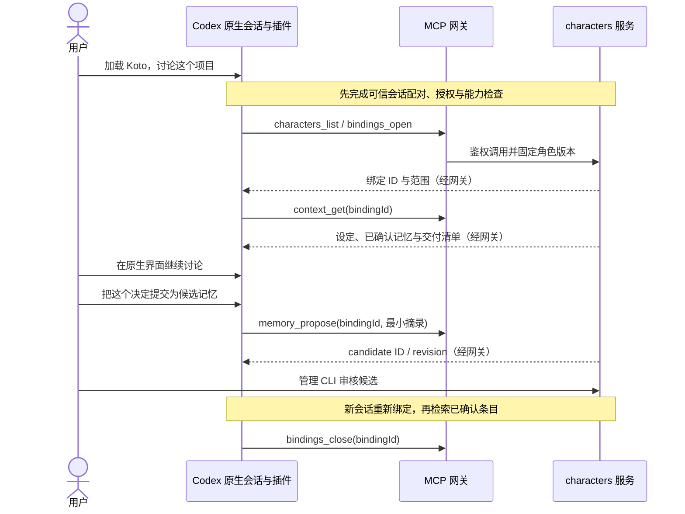

# Codex 插件最小闭环

状态：v0.2，2026-10-25；2026-11-05 起 M5 暂缓，当前状态见[实现状态](status.md)，路线图 R5 再评估。M4 网关、M5 通用接入包 prepare/doctor 及实际 Codex 无模型协议测试已实现；生产宿主验证器与 strict 原生闭环未做。当前可执行步骤见[网关指南](mcp.md)，M0 实验见[验证报告](codex-m0.md)。本文其余未实现目标与当前状态分开描述。Codex 使用 characters 的调用方向与[早期执行试用](codex.md)相反。

## 接入目标

用户自己启动 characters 管理服务、自己打开 Codex。插件让 Codex 发现并按需读取角色设定、检索已确认记忆、提交候选。对话、模型登录、工具权限、文件操作和任务生命周期保持在 Codex。插件不建立自己的聊天循环，也不要求 characters 保存完整宿主聊天。

首个验收目标为本地 Codex CLI；桌面端、IDE 和其他宿主分别建立证据。通用插件安装一次即可使用授权角色，不为 Koto 创建全局人格技能，也不把完整角色库复制到宿主配置。

## 接入包组成

| 内容         | 责任                                                          |
| ------------ | ------------------------------------------------------------- |
| 插件清单     | 插件身份、版本、协议兼容范围、技能/MCP 入口                   |
| 通用接入说明 | 显式加载、读取内容的语义、记忆写回和退出处理                  |
| MCP 配置模板 | 启动通用 stdio 网关，连接用户明确指定的工作区服务             |
| 本地配置     | 非分发内容；服务位置和受保护凭证引用，不包含角色正文          |
| 能力验证器   | 针对固定 Codex 版本检查会话关联、记忆策略、实际输入和工具预算 |

`plugins/codex/` 已包含通用技能、MCP 模板及兼容清单。M0 的临时插件与新增生成包测试验证了本机兼容清单 `.codex-plugin/plugin.json` 与 `.mcp.json`；仅 portable root 清单在该版本未完整识别。当前固定兼容格式，宿主格式和 characters 的协议版本分开发布；包可识别不代表生产 strict 就绪。

通用说明只描述接入流程，不包含角色人格；首次安装不自动加载任何角色。对用户未指定角色的请求，插件不得隐式采用 default 或上次使用角色。自然语言“加载 Koto”等是拟议体验，不宣称存在自定义 `/koto` 命令。

## 首轮配置与鉴权

以下为目标路径；当前 prepare/pair/doctor 的可执行用法见 mcp.md。生产会话验证与安装后的原生试用仍未实现/验收：

1. 管理 CLI 初始化独立数据工作区、安装 Koto，运行 `service serve --workspace PATH`。
2. 用户通过 `connection grant` 选择 codex-cli、可用角色、用途/项目/共享背景与期限，默认 strict。
3. `plugin codex prepare --output PATH --workspace PATH` 生成通用接入包和非秘密配置模板；受保护的网关凭证在用户本地保存，不进入插件分发文件。
4. 用户按当前 Codex 支持的本地安装/配置方式接入。任何全局安装或配置调整都需明确展示路径和作用范围，prepare 不替用户执行。
5. 新建 Codex 会话，插件与实际会话建立可信配对并完成 doctor；通过后才开放角色内容加载。

服务管理凭证不传给 Codex 网关；网关只拥有已授权操作。characters 不需要接触 Codex 的 ChatGPT 登录或 API key。此前执行试用的认证副本处理不成为插件的前置步骤。

## agent 可见工具

只暴露[统一契约](contracts.md)的六个工具：characters_list、bindings_open、context_get、memory_search、memory_propose、bindings_close。参数和结果与领域操作一一映射，不增加角色数据的第二份规则。

MCP 工具返回角色文本和有来源的记忆分区，由插件说明指导宿主使用。MCP 返回值不会自动变成系统指令，插件也不能覆盖 Codex 的系统安全规则；真实角色遵循度需人工检查。需要原生上下文注入时，单独验证宿主提供的能力，不能以工具名“activate”声称已经注入。

不暴露角色更新、记忆确认、凭证签发、任意文件读取、工作区切换或通用执行工具。原本 Codex 的 shell/编辑等能力由宿主控制，角色服务不额外授权或代理。

## 原生使用路径

工具调用不能接收模型自填的 actor=user；审核必须经过管理面。source 的 hostMessageRef 只是定位提示，摘录由宿主提供，服务记录来源可信度而不声称独立读取了原聊天。

首版不需要文章、Work、Session、Run 或自动提取。结束时没有提出候选就没有写回，不能依赖退出 hook 一定触发。服务不取消 Codex 正在执行的任务。

## 会话关联与能力证据

最早的可行性检查必须回答：同一 MCP 子进程是否可能服务多个 Codex 会话，工具调用是否提供可靠的当前会话关联，插件如何在提供私有信息之前检查本会话记忆策略。不能把进程 PID、工作目录或 MCP 客户端名称当成真实会话 ID。

如果需要用户逐会话配对，配对只能绑定当前已验证的连接/会话；复用旧配对到其他窗口必须拒绝。若宿主不能提供或可靠隔离该关联，多窗口接入保持不支持，不能伪造多个 binding 来宣称已隔离。

doctor 只能由可信本地验证器产生证据，插件说明和模型 tool call 不能写 pass。证据与宿主会话、版本、有效配置、验证器/插件版本和适用二进制关联；失效后服务拒绝下一次正文交付与写回。

| 能力                | 首版处理                                                       |
| ------------------- | -------------------------------------------------------------- |
| 角色内容取得        | MCP 工具实际返回文本与清单，验证宿主没有静默截断必需设定       |
| 全局记忆读取        | 必须在加载前验证已关闭；不能用“没有提起诱饵”证明               |
| 全局记忆生成        | 必须验证本会话不进入生成输入；不能把不上传聊天等同关闭宿主记忆 |
| 原生上下文注入      | 可选，若未知则只声明 tool-result，不声称系统级注入             |
| 退出/切换           | 默认新会话；未知清理能力如实记录                               |
| 自动 lifecycle hook | 可选；首版显式加载、提交和关闭，期限作为中断兜底               |
| 文件权限            | 宿主控制；不是 characters 全盘沙箱                             |
| 提供商保留          | 独立记录，未知不得显示为零保留                                 |

OpenAI 官方文档说明了插件由技能和 MCP 等资源组合、Codex 的 MCP 接入及会话记忆控制；这些是需要验证的机制依据，不是任意已安装版本都已通过验证的证据。能力检查不可自动修改全局记忆设置；本会话策略无法可靠确认时，默认 strict 阻止设定与记忆交付，只允许受授权的最小目录/诊断。

用户可在管理端明确选择 relaxed，记录未满足条件，但 relaxed 演示不算 strict 完成。无法做到的能力保持 unknown，不用模型保证、关闭文件时间戳检查或旧执行适配器证据补齐。

## 退出、撤销与故障

- 正常结束时显式 close，尽力 hook 只能作为增强。强制退出后依赖绑定期限或用户 revoke。
- 已关闭、过期、撤销和旧服务世代的绑定拒绝正文查询、历史快照下载与写回。
- 服务断线时显示服务不可用，不自动换角色、不偷偷启动新 agent、不离线保存第二份记忆。
- 同 requestId 重试已提交候选返回原记录，不重复创建；新请求也需通过当前权限检查。
- 宿主上下文已含角色时，关闭不会抹去聊天或变回原人格；默认指导用户开启新会话。
- 启用/停用只操作本次绑定线程；不修改全局或项目插件状态，不卸载公共插件，不全局 reload MCP。含角色历史的当前线程在关闭后继续禁止全局记忆生成，避免历史内容被后台提取，其他会话策略保持原样。
- 新会话从已确认状态建立新快照，不把旧对话、旧候选或旧角色激活记录自动带入。

## 验收证据与实施界限

先进行包/清单校验、假客户端 MCP 测试、实际 Codex 本地请求捕获和并发会话检查；常规测试不使用真实凭证或模型。经用户明确授权后，再进行一次原生 Codex 对话、候选审核、新会话取回与退出。

结果分别记录：插件安装有效、工具连接有效、角色内容加载有效、会话隔离有效、全局记忆读写策略有效。模型像 Koto、访问目录元数据未变或 MCP initialize 成功，均不能单独替代这些检查。

M0 实测与未完成能力见[验证报告](codex-m0.md)。官方机制参考（查阅日期 2026-10-25）：

- [插件打包](https://developers.openai.com/plugins/build/plugins)
- [技能构建](https://learn.chatgpt.com/docs/build-skills)
- [MCP 接入](https://learn.chatgpt.com/docs/extend/mcp)
- [Codex 本地记忆与会话控制](https://learn.chatgpt.com/docs/customization/memories)

这些链接用于实现 M0 时复核；实际格式、安装命令与宿主能力须以目标版本的测试结果更新，不能只按文档推定。
