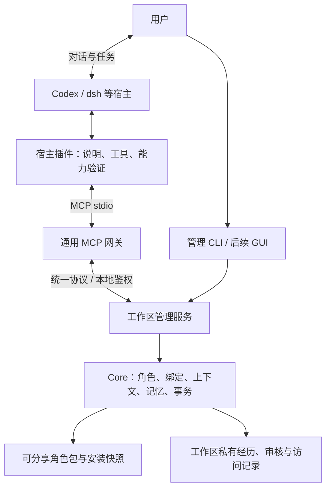

# characters 系统设计

设计版本：v0.2，2026-10-25。M1 至 M4 的协议、管理服务、上下文/记忆业务和 MCP 网关已实现；M5 已提供通用包准备与原生无模型协议测试，生产宿主验证器及 strict 尚未验收。实施状态以[第一阶段计划](phase-1.md)为准，数据和接口以[统一契约](contracts.md)为准。

## 产品定位

characters 是本地、可插拔的角色与记忆管理系统。它保存角色是谁、经历过什么，以及哪些经历可以用于本次交流。用户启动管理服务，Codex、dsh 等宿主通过各自插件访问角色；对话、模型调用、工具执行和任务调度留在宿主。

博客写作是应用场景之一，开发讨论、资料整理和日常交流同样适用。产品不要求先创建文章、作品或 characters 自有聊天会话，才能使用角色。

管理 GUI 负责角色库、记忆审核、接入授权和使用记录。它不提供主聊天界面、模型配置或 agent 任务执行台。管理服务不需要模型凭证，不建立 agent 推理循环。

## 架构与职责



| 模块           | 职责                                                   | 不承担的职责                             |
| -------------- | ------------------------------------------------------ | ---------------------------------------- |
| Core           | 角色安装、上下文选择、绑定授权、记忆状态机、事务与恢复 | 宿主 SDK、模型调用、传输协议实现         |
| 管理服务       | 一个显式工作区的生命周期、鉴权、统一操作分发           | 聊天托管、任务执行、全局活动角色         |
| 统一协议       | 版本、请求结果、能力、绑定、上下文与候选记忆语义       | 某个宿主的命令和提示格式                 |
| MCP 网关       | MCP 工具与统一操作互转，连接已有服务                   | 私有存储副本、独立记忆规则、自动启动宿主 |
| 宿主插件       | 接入说明、工具配置、上下文使用指导、宿主能力验证       | 更改角色数据规则、用提示词替代隔离       |
| 管理 CLI / GUI | 设定、授权、审核、诊断、记录                           | 代替用户与角色交流                       |

插件不等于角色包。插件包含可信接入代码与说明；角色包只包含数据，不能携带可执行钩子或授予工具权限。插件安装不等于启用角色，更不等于允许读取私人经历。

## 关键对象

| 对象                           | 含义                                                                      |
| ------------------------------ | ------------------------------------------------------------------------- |
| CharacterPackage               | 可分享、版本化的身份、性格、关系、表达和模式                              |
| CharacterState                 | `(workspaceId, characterId)` 所属的私有经历；同一角色在其他工作区独立成长 |
| ConnectionGrant                | 用户允许某个宿主接入读取哪些角色、用于什么范围；与实际凭证关联            |
| HostSession                    | 宿主中的一次逻辑交流；由插件关联，用于作用域，不是鉴权凭证                |
| Binding                        | 一次角色使用：固定角色版本、调用方、宿主会话、用途、权限和有效期          |
| ContextDelivery                | 某次实际交付的上下文快照、来源、记忆 revision、大小预算及摘要             |
| MemoryCandidate / MemoryRecord | 有来源的候选、审核决定及生效状态                                          |
| AccessRecord                   | 加载、检索、候选提交、关闭、撤销和失败的脱敏记录                          |

角色身份不绑定 PID。一个服务管理多个角色，每个角色可被多个绑定使用；不需要每个角色常驻一个进程。同目录的两个窗口也不能被自动视作同一会话。首版每个绑定只含一个角色，同一宿主会话只允许一个活动角色绑定；切换以新会话为默认路径。

角色启停必须按绑定线程可插拔，不影响没有使用该角色的其他宿主会话。禁止用全局/项目插件开关、安装/卸载或全局 MCP reload 作为角色生命周期操作。M0 已实测受控 App Server 的线程级能力，原生现有会话接入尚未验收，详见[能力报告](codex-m0.md)。关闭后含有角色历史的线程不能恢复全局记忆生成，否则旧内容仍可能被提取；其他线程保持原策略。

已有 Work、Session、Run 属于早期写作执行切片。它们可继续使用，但不作为插件协议的必填对象；绑定不复用旧 Session ID，宿主聊天不冒充本地 Message。

## 管理服务与传输

首版单机、单用户；每个显式工作区最多一个服务实例。`service serve` 前台运行，用户管理进程生命周期。多个工作区可以分别启动，禁止根据 HOME 或请求中的任意路径寻找工作区。

最小实现采用绑定 `127.0.0.1` 随机端口的本地 HTTP RPC。MCP 网关作为宿主插件的 stdio 子进程，转发到管理服务；网关不拥有数据、不在断线后自动切换成另一个存储服务。HTTP RPC 是本地内部传输，MCP 负责宿主工具接入，两者不是旧 JSONL 执行 worker 协议。

服务描述符只在工作区 `.runtime/service/` 保存端点、服务世代、协议版本及本地凭证引用，采用安全权限和原子创建。所有 RPC 都需鉴权，包括状态检查；只监听回环、拒绝非预期 Host/Origin，不开放浏览器跨域或远程监听。GUI 后续接入时另行设计浏览器授权。

工作区锁继续只覆盖短暂存储事务。服务独占标记与 P2 存储锁分开；网络等待不持有存储锁。停机、死锁回收与未知 owner 均需验证，不通过杀死任意同端口进程“修复”。

## 统一协议与插件

共用协议提供发现角色、创建绑定、取得上下文、检索记忆、提交候选和结束绑定。MCP 与管理入口的操作集分开：agent 无权批准记忆、修改角色设定或给自己扩大权限。

每个插件至少提供版本化宿主描述、接入说明、工具映射、能力检查和退出处理。能力可以不同：基础插件按需调用工具；原生生命周期事件可作为增强能力。没有对应宿主 API 时，插件不得宣称能自动注入、自动总结、清理上下文或控制全局记忆。

Codex 是首个具体接入目标，先验证本地 CLI 的原生交互；桌面端单独验收。插件由通用接入说明和 MCP 工具组合而成，不为每个角色安装一份技能。Koto 设定和私有经历只在明确加载时返回。

安装和配置只生成到用户明确指定的本地范围。首次实现不默认改写宿主全局配置、全局 AGENTS.md、全局技能或人格；需要用户宿主设置的步骤明确展示。dsh 仅保留扩展位置，具体 API、打包和能力尚未调查，不标记为已支持。

## 最小使用闭环

1. 用户初始化工作区、安装 Koto，前台启动管理服务。
2. 生成本地 Codex 接入包，在宿主支持的本地范围安装并由用户授予访问范围。
3. 在新 Codex 会话明确请求加载 Koto。插件先取得可验证的本会话能力证据，不能读取角色设定后才尝试关闭记忆。
4. 服务验证身份、授权、会话能力与范围，创建绑定并固定角色包摘要。
5. Codex 调用 `context.get`，取得实际设定、选中的已确认记忆与清单，在原生界面与用户交流。
6. 用户要求记住某个决定，Codex 调用 `memory.propose`，仅上传必要摘录与来源说明。
7. 用户通过管理 CLI 审核；后续显式检索/加载时才取得新确认的记忆，不向活动会话后台广播。
8. 绑定关闭、撤销或到期，服务拒绝后续角色访问；宿主退出角色使用新会话或经验证的清理能力。

不采集完整宿主聊天，不要求生成文章，不自动调用模型提取记忆，不要求 GUI 才能完成闭环。

## 上下文、记忆与隔离

上下文由固定版本的角色设定、用户明确选择的用途与共享背景，以及归属当前角色且范围匹配的已确认记忆组成。先按授权过滤，再检索与排序；缓存键包含工作区、角色、绑定范围、角色摘要、策略摘要和记忆版本，不能仅用关键词或当前目录。

必需设定超预算时失败；可选记忆按确定顺序限量，并记录排除理由。快照只证明管理服务交付了什么，不证明宿主的完整模型输入。宿主请求捕获是独立证据。

候选、拒绝、撤回和替代条目不进入有效长期记忆检索。搜索不改变审核状态，不能因“被命中很多次”自动确认。审核状态、来源可信度与事实/观点类别分开；用户确认保存也不证明内容客观正确。宿主摘录是调用方提供的证据，不伪装成服务独立核实的原始聊天。

每次受保护的调用重新验证绑定状态、授权 revision、凭证有效性和宿主证据，不只在加载时检查。撤销后不能通过旧 snapshot ID 下载历史私有内容；管理端显式审计查看不受这个宿主下载接口约束。内容已经交付后无法远程收回。

`strict` 为默认，要求宿主本会话的全局记忆读取和生成策略均有有效证据。证据必须来自可信验证器，绑定实际宿主版本、配置和会话；模型自报、MCP clientInfo、插件安装成功和通用说明均不是证明。未知、过期或环境变更时拒绝角色设定与记忆加载，可保留受授权的最小角色目录信息。

`relaxed` 仅由用户在管理端显式选择并记录缺项；agent 不能自行降级。不以 CLI 的隔离结果推断桌面当前会话安全。无法建立 Codex 当前会话的可靠检查时，首版 strict 验收未通过，停在接入诊断，不自动变成启动器或自建聊天产品。

服务控制自己的文件和返回范围；宿主拥有文件工具时，仍可能访问本机其他目录。该边界不是防恶意同用户进程的 OS 沙箱，也不承诺提供商零保留。角色管理服务不请求或代理模型认证。

## 文件布局与迁移

以下布局区分已实现基础与计划位置，不创建空占位实现：

```text
packages/core/              # 已有；扩展绑定、记忆状态机、交付记录
packages/cli/               # 已有；新增管理命令
packages/adapters/          # 已有；保留早期 Codex 执行试用
packages/protocol/          # 已实现 M1 请求、响应、版本与准入
packages/service/           # 已实现 M2；一个工作区的本地管理服务
packages/mcp/               # 已实现；通用 stdio 网关，显式线程配对
plugins/codex/              # 通用接入包；生产宿主验证器和 strict 未验收
apps/manager/               # 后续；管理 GUI
characters/koto/            # 已有；分发定义
```

```text
workspace.yaml / characters.lock / packages/     # 保留已实现格式
states/koto/memories/                            # 已有 v2 结构与迁移，业务在 M3
connections/<connection-id>.json                 # 已实现；非秘密授权信息
bindings/<binding-id>/binding.json               # 已实现；使用绑定
bindings/<binding-id>/deliveries/<snapshot-id>/   # 计划；受保护快照及清单
bindings/<binding-id>/proposals/                 # 计划；最小来源摘录
audit/                                          # 已实现；无正文的访问记录
.runtime/service/                               # 已实现；描述符、凭证、服务锁
sessions/ / works/                              # 已有；保留早期执行切片
```

新协议版本与持久 schemaVersion 独立。不能把示例字段直接写入目前 strict schema 的 workspace.yaml。扩展数据格式、存储允许路径和生成 schema 时必须显式迁移并测试旧工作区，见[统一契约](contracts.md)。已有写作试用不删除，旧调用方向只用于兼容与回归；不继续将通用执行器作为新主线。

## 后续范围

先完成服务、协议和一个 Codex 插件闭环，再增加管理 GUI、第二宿主及角色升级。市场、云同步、自主活动、跨角色群聊、自动发布、后台记忆抽取与任意可执行角色包不属于这个最小闭环。
